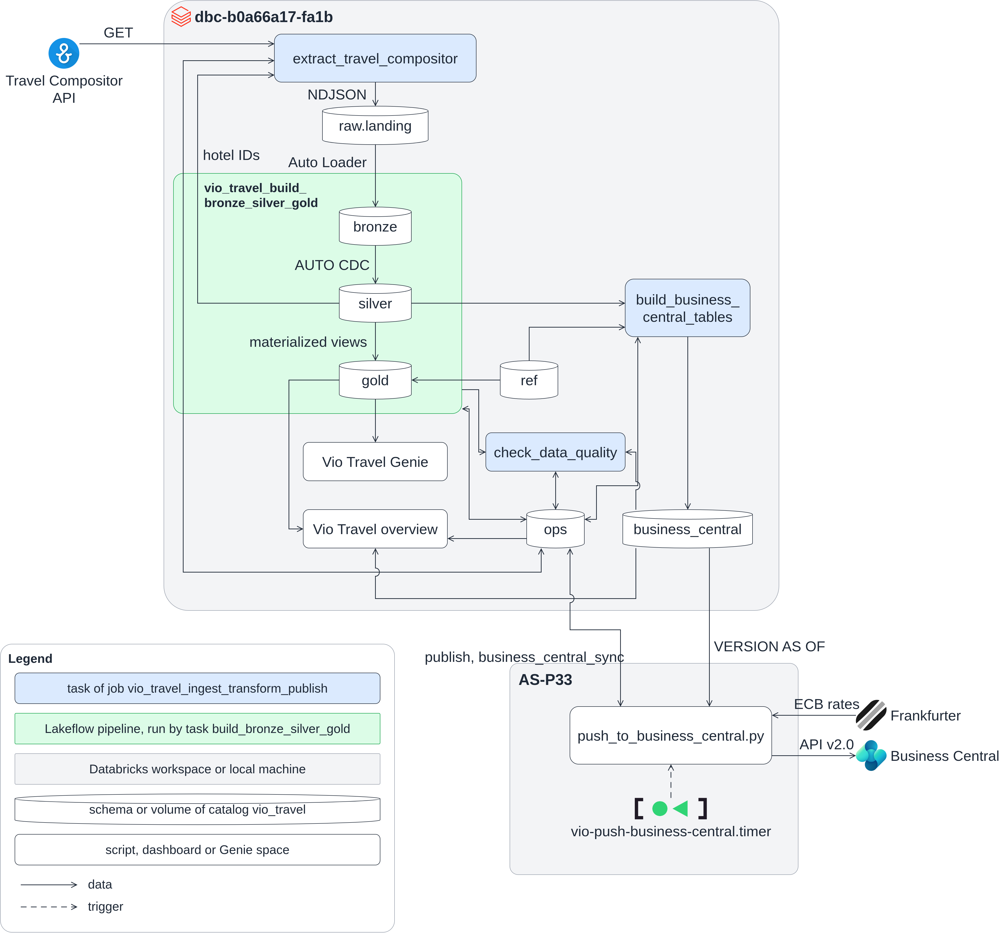
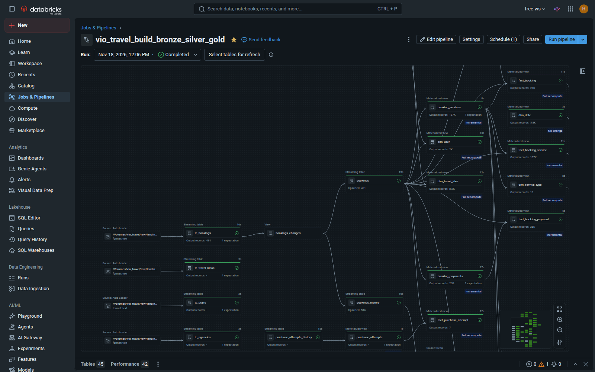
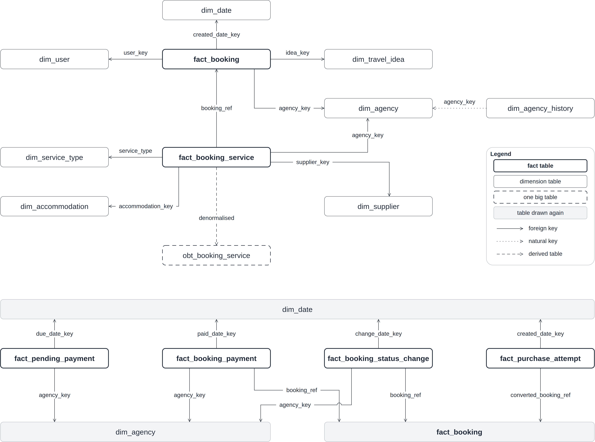
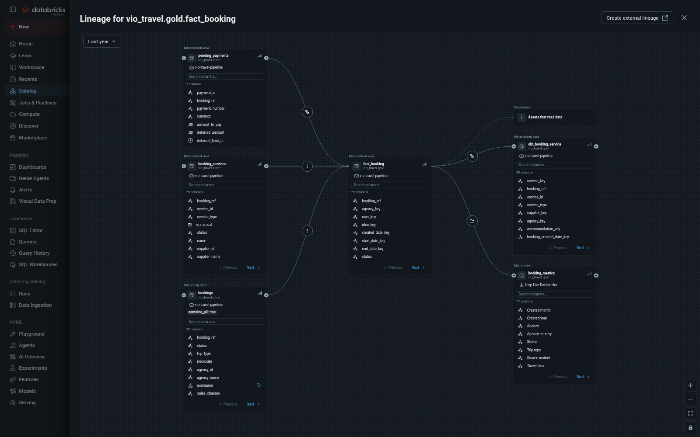
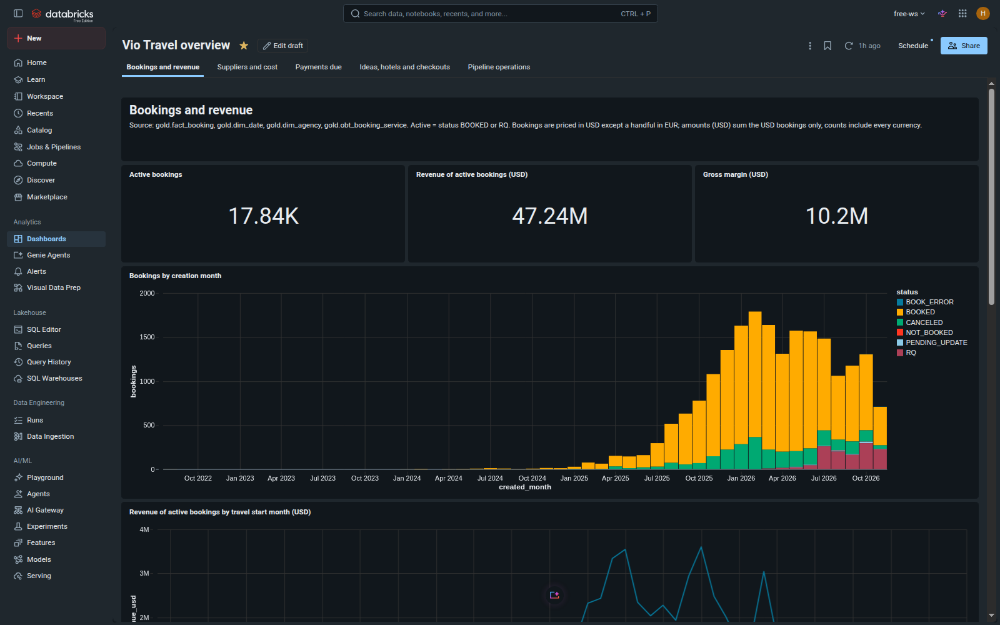
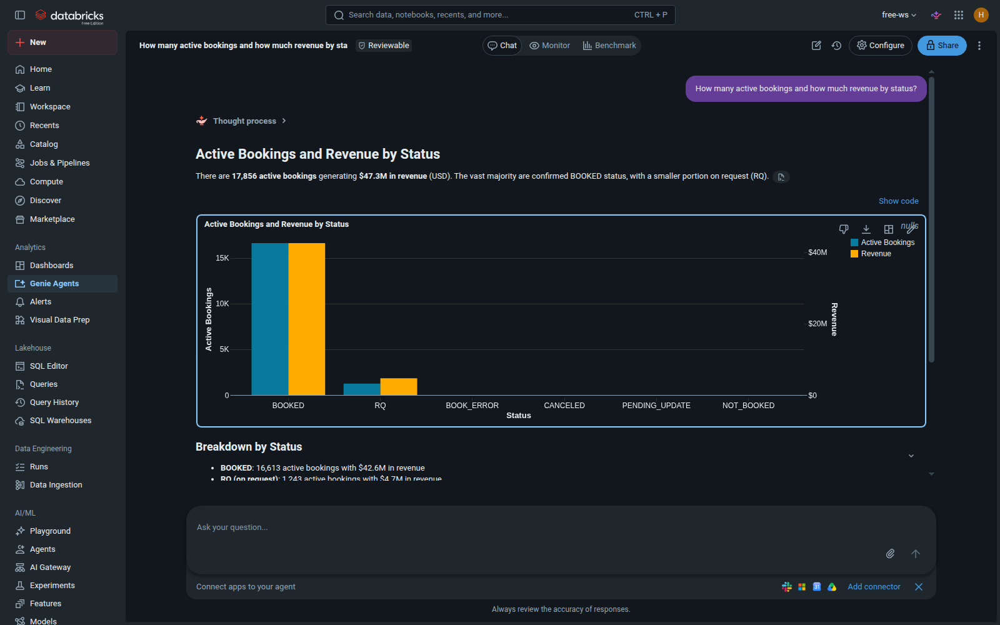
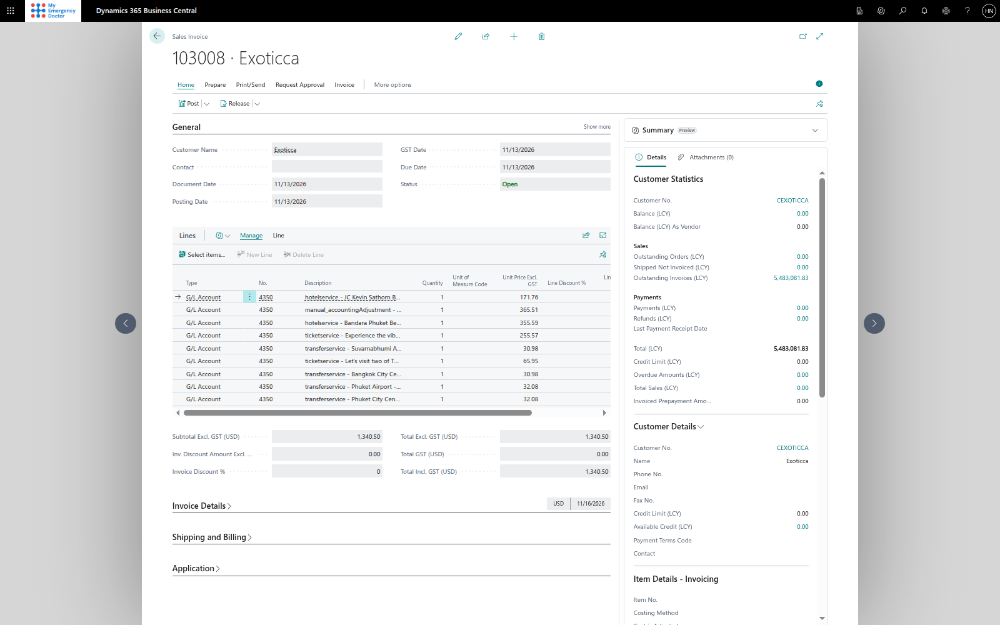
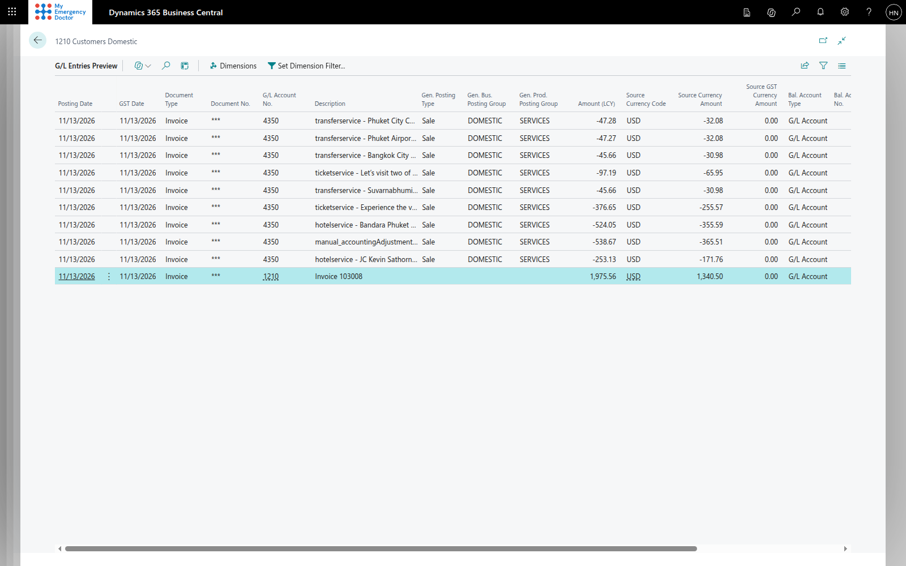
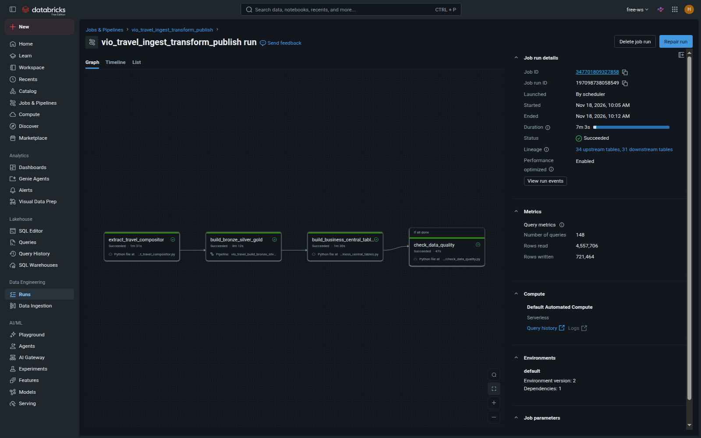

# vio-data-platform

A Databricks lakehouse for Vio Travel, a destination management company that sells its tours through Travel
Compositor. The platform reads the Travel Compositor REST API, keeps every record and its history in the Unity Catalog
catalog `vio_travel`, models bookings as a star schema for an AI/BI dashboard and a Genie space, and turns them into
draft sales and purchase invoices in Microsoft Dynamics 365 Business Central.

It is a lab. It runs in a Databricks Free Edition workspace and writes into the company `My Company` of a Business
Central trial. The Travel Compositor API is only read: GET requests and the authenticate POST.



## Contents

- [Architecture](#architecture)
- [Unity Catalog layout](#unity-catalog-layout)
- [Ingestion](#ingestion)
- [Transformation](#transformation)
- [Data model and serving](#data-model-and-serving)
- [Business Central integration](#business-central-integration)
- [Orchestration](#orchestration)
- [Data quality](#data-quality)
- [Monitoring and freshness](#monitoring-and-freshness)
- [Performance and cost](#performance-and-cost)
- [Governance and security](#governance-and-security)
- [Conventions](#conventions)
- [Development](#development)
- [Operations](#operations)
- [Limitations](#limitations)

## Architecture

| Stage | Runs as | Code | Output |
|---|---|---|---|
| Extract | task `extract_travel_compositor` of job `vio_travel_ingest_transform_publish` | `src/extract_travel_compositor.py` | gzip NDJSON files in volume `raw.landing`, run log in `ops` |
| Bronze, silver, gold | Lakeflow pipeline `vio_travel_build_bronze_silver_gold`, task `build_bronze_silver_gold` | `src/build_bronze_silver_gold/` | schemas `bronze`, `silver`, `gold` |
| Integration tables | task `build_business_central_tables` | `src/build_business_central_tables.py` | schema `business_central`, published versions in `ops.publish` |
| Integration documents | task `build_business_central_documents` | `src/build_business_central_documents.py` | booking versions, posted sales and purchase documents in `business_central` |
| Checks | task `check_data_quality` | `src/check_data_quality.py` | `ops.dq_results` |
| Push | systemd timer `vio-push-business-central.timer` on a workstation | `local/push_to_business_central.py` | draft invoices in Business Central, `ops.business_central_sync` |
| Serving | AI/BI dashboard `Vio Travel overview`, Genie space `Vio Travel Genie` | `dashboards/`, `genie/`, metric views in `src/apply_governance.py` | |

The design is ELT. API responses are landed unchanged and every transformation runs inside Databricks, so a parsing
bug is fixed by replaying the landed files instead of calling the API again.

| Path | Content |
|---|---|
| `databricks.yml`, `resources/` | Databricks Asset Bundle: schemas, volume, pipeline, 4 jobs, dashboard, Genie space, SQL alert |
| `src/` | job tasks; `src/build_bronze_silver_gold/` holds the pipeline source, one file per layer |
| `dashboards/build_dashboard.py`, `genie/build_genie_space.py` | generators of the dashboard and Genie JSON; edit the script, never the JSON |
| `local/` | the Business Central push, its config, systemd units, `extend_number_series.py` |
| `sql/` | one-time setup: `setup-catalog.sql` (catalog, grants, `ref` tables), `ref-maps-lab-seed.sql` (lab mappings, never used in production) |
| `tests/` | unit tests of the API client, the backfill planner, the push logic, SQL shared by the pipeline and the push, every statement of `build_business_central_documents` parsed as Databricks SQL, and its document rules run on a local Spark session |
| `docs/` | `data-flow.drawio`, `star-schema.drawio` and their PNG exports, screenshots of the workspace and Business Central |
| `.github/workflows/ci.yml`, `.githooks/pre-push` | the same checks in GitHub Actions and before every local push |

## Unity Catalog layout

Each environment has its own catalog: `vio_travel` for target `prod`, `vio_travel_dev` for target `dev`. Schemas follow
the medallion layers, plus one schema each for the integration output, reference data and operations.

| Schema | Holds | Written by | Read by |
|---|---|---|---|
| `raw` | volume `landing`: one folder per entity, ingest date and run; files kept 90 days | `extract_travel_compositor` | pipeline |
| `bronze` | `tc_<entity>`: one VARIANT row per landed record with file and run metadata, append-only | pipeline (Auto Loader) | pipeline for bookings and accommodations; the permanent archive for snapshot entities |
| `silver` | current state per entity and `<entity>_history` (SCD (slowly changing dimension) type 2, with validity dates); typed columns | pipeline, plain views from `vio_travel_apply_governance` | `build_business_central_tables`, engineers |
| `gold` | star schema `dim_*`, `fact_*`, one big table `obt_booking_service`, metric views `*_metrics` | pipeline, `vio_travel_apply_governance` | every workspace user, personal columns masked |
| `business_central` | `customers`, `vendors`, `sales_invoices`, `sales_lines`, `purchase_invoices`, `purchase_lines`, shaped like Business Central API v2.0; `booking_versions`, `sales_documents`, `purchase_documents`, shaped like the implementation partner specification | `build_business_central_tables`, `build_business_central_documents` | `local/push_to_business_central.py` reads the first six |
| `ref` | `umbrella_agency`, `customer_map`, `vendor_map`, `business_central_code_map`: mappings owned by Finance | Finance, through SQL | `build_business_central_tables`, `build_business_central_documents`, pipeline |
| `governance` | function `mask_pii` | `vio_travel_apply_governance` | column masks |
| `ops` | `api_calls`, `ingest_runs`, `watermark`, `accommodation_fetch`, `pipeline_event_log`, `build_state`, `dq_results`, `publish`, `business_central_sync` | every task and the push | dashboard page Pipeline operations, SQL alert |

Schemas and the volume are bundle resources (`resources/schemas.yml`), and the schemas that hold history have the
bundle setting `prevent_destroy`. The pipeline definition writes its event log to table `ops.pipeline_event_log`. The
catalog is created once by `sql/setup-catalog.sql`, because a catalog on Default Storage cannot be created through the
catalogs API.

## Ingestion

`src/extract_travel_compositor.py` declares every entity in one registry and reads it in one of three modes.

| Mode | Entities | Strategy |
|---|---|---|
| incremental | bookings (`/booking/getBookings`) | by last-update date from `ops.watermark`, 1-day overlap, 7-day windows; the API filters by day only, so each run reads today and yesterday again |
| snapshot | agencies, suppliers, users, travel ideas every 6 hours; pending payments and purchase attempts every run; the accommodation catalog (283 pages) weekly in job `vio_travel_ingest_accommodation_catalog` | every page of the list in one run |
| by id | datasheets of booked hotels | 200 per run, refreshed after 30 days |

### Reliability

- Retries with exponential backoff and full jitter on HTTP 429, 5xx, network errors and truncated JSON: up to 6
  attempts, at most 120 seconds apart, honouring `Retry-After`. The token is renewed 5 minutes before it expires and
  shared by parallel readers.
- The extract compares the distinct keys landed with the API field `totalResults` for every window and snapshot. A short
  booking window is read again; if it is still short it is recorded as `PARTIAL` and the watermark does not move. A
  short snapshot is read a second time: the same keys twice means `totalResults` overstates and the snapshot counts,
  other keys make it `PARTIAL`. The pipeline applies only `SUCCESS` snapshots, because it closes every key missing
  from the snapshot it applies.
- Each API page is written as a `.tmp` file and renamed, so Auto Loader never reads a half-written file.
- Every HTTP attempt is logged in table `ops.api_calls`, every window and snapshot in table `ops.ingest_runs`.

Webhooks are not used, because they need a URL registered on Vio's Travel Compositor account, which is a write to the
source system. Contracts and `/manual-exchange-rates` (HTTP 401 for this API user) are not read.

## Transformation

The Lakeflow Spark Declarative Pipeline `vio_travel_build_bronze_silver_gold` (serverless, triggered, channel
`CURRENT`) builds the three layers.

| Layer | Technique |
|---|---|
| bronze | Auto Loader (`cloudFiles`) streaming tables, one per entity; exactly-once per file; `pipelines.reset.allowed = false`, so a full refresh never empties them |
| silver, bookings | `AUTO CDC` keyed on `booking_ref`, sequenced by `lastUpdateDate` then load time: SCD type 1 in `bookings`, SCD type 2 of status and amounts in `bookings_history`; a late or replayed version never overwrites a newer one |
| silver, snapshot entities | `AUTO CDC FROM SNAPSHOT`: each pipeline update applies the next complete extract run, read from its landing files, because a snapshot source cannot read a table of its own pipeline; SCD type 2 in `<entity>_history` also closes keys that disappear, such as a paid pending payment |
| silver, child tables | materialized views exploding the booking payload: `booking_services` (one row per service, every service array), `booking_payments` |
| gold | materialized views, refreshed incrementally on serverless when the query plan allows |

### Incremental processing

The extract reads only changed bookings, Auto Loader picks up only new files, and the streaming tables process only
new bronze rows. Task `build_business_central_tables` skips its rebuild when silver and `ref` did not change since the
last publish (table `ops.build_state`).

A pipeline full refresh rebuilds silver and gold from bronze. Bronze and the snapshot history tables are excluded,
because their history exists only there.



## Data model and serving



`gold` is a Kimball star schema. Dimensions are SCD type 1 with member `-1` (Unknown) for missing keys. The
table `dim_agency_history` answers as-of questions. Tables carry informational primary and foreign keys; the primary
keys have `RELY`, which lets the optimizer remove redundant joins, and Genie reads both kinds to join tables.



| Table | Grain |
|---|---|
| `dim_date` | one calendar day, 2015 to 2030, key `date_key` (yyyyMMdd) |
| `dim_agency`, `dim_agency_history` | one agency; one agency version |
| `dim_supplier` | one supplier: `SP<id>` for a Travel Compositor supplier, `PV<code>` for a provider, `MN:<name>` for a manual service |
| `dim_service_type` | one service type with its category |
| `dim_user` | one microsite user, key SHA-256 of agency and username |
| `dim_travel_idea` | one travel idea (a packaged itinerary) |
| `dim_accommodation` | one booked hotel |
| `fact_booking` | one booking, current state |
| `fact_booking_service` | one service of a booking, with sale and cost amounts |
| `fact_booking_payment` | one payment received |
| `fact_pending_payment` | one payment due; days overdue are computed at query time, so they keep counting when the pipeline stops |
| `fact_booking_status_change` | one version of a booking's status and amounts, the first version included, from `silver.bookings_history` |
| `fact_purchase_attempt` | one checkout started, converted or not |
| `obt_booking_service` | `fact_booking_service` joined with every dimension, for ad-hoc SQL and Genie |

The metric views `booking_metrics`, `service_metrics` and `receivable_metrics` (YAML 1.1) define revenue, margin,
cancellation rate, cost by supplier and amounts due once, for the dashboard KPI tiles, Genie and SQL users. Amounts stay in the
booking currency and every metric view has a `Currency` dimension, so no total adds two currencies.

The dashboard `Vio Travel overview` has 5 pages, named Bookings and revenue, Suppliers and cost, Payments due, Ideas,
hotels and checkouts, and Pipeline operations. The dashboard runs with each viewer's permissions, and only data
engineers can read `ops` and `business_central`, so the Pipeline operations page is for them. The Genie space `Vio Travel Genie` reads the 3 metric views and 10 gold
tables, and answers with the permissions of the user who asks.





## Business Central integration

Business Central is the accounting system. The integration creates draft documents that Finance reviews and posts; it
never posts.

| Business Central object | Built from | Key |
|---|---|---|
| customer | Travel Compositor agency, or the customer that `ref.customer_map` assigns to a booking of an umbrella agency | `AG<agency id>`, or the number in `ref.customer_map` |
| vendor | Travel Compositor supplier, provider code of an API service, or `ref.vendor_map` for manual services | `SP<id>`, `PV<code>`, or the number in `ref.vendor_map` |
| sales invoice | one per booking in status BOOKED, RQ (on request) or CANCELED, one line per active service (sale price plus amendments) | `externalDocumentNumber` = booking reference |
| purchase invoice | one per service with a cost (net cost plus amendments) | `vendorInvoiceNumber` = service id and type code |
| currency exchange rate | rate of the ECB (European Central Bank) from the Frankfurter API; for currencies the ECB does not publish (VND, Vietnamese dong; FJD, Fiji dollar), the median Travel Compositor cost rate of at least 3 nearby services | currency and date |

`build_business_central_tables` rebuilds the six tables, runs its blocking checks, and records their Delta versions in
table `ops.publish` only when every check passes (write-audit-publish). The push reads only published versions; data
files are kept 30 days so an older published version stays readable while checks fail. A document that cannot be sent
gets a value in column `hold_reason`, such as `CUSTOMER_UNMAPPED` or `VENDOR_UNMAPPED`, and waits for a mapping.

`local/push_to_business_central.py` runs on a workstation because the tenant allows only a delegated Azure CLI login,
not an app registration. Each run:

1. Asks the Jobs API whether `vio_travel_ingest_transform_publish` finished a run since the last push.
2. Reads the six tables `VERSION AS OF` the last published versions, so it sees one consistent, checked build.
3. Compares each document's `payload_hash` with its last result in table `ops.business_central_sync` and selects up to
   100 bookings with changes, oldest first. New documents are taken only when the invoice date or last update falls
   in the last 30 days (`scope_sql` in `local/config.json`; `--scope_sql` widens it for a backfill); a document sent
   before whose payload changed is always taken.
4. Upserts customers and vendors, and loads missing exchange rates through a RapidStart configuration package.
5. Creates a draft with its lines in one deep-insert POST, or replaces the header and lines of an existing draft in one
   transactional OData `$batch`. A posted document is never changed and is reported with status `NEEDS_CREDIT_MEMO`. A
   cancelled booking or service empties its draft so it cannot be posted. Travel Compositor usually sets the cost of
   a cancelled service to 0, so the tables keep every cancelled service, and a booking left without lines, as a `CANCEL` row; a
   synced document that disappears from the tables is emptied as well, and more than 50 at once
   (`max_removals_per_run`) stop that step for a person to check. Drafts are never deleted, because deleting a numbered
   draft makes Business Central create an empty posted invoice.
6. Writes one result row per document into `ops.business_central_sync` after every booking.

POST is retried only on HTTP 429, because a POST that failed with 5xx may have been committed; the next run finds the
document by its key and updates it instead of creating a duplicate. A document that fails 3 times with the same hash
waits as a dead letter until its data changes or the push runs with `--retry FAILED`.

A pushed sales invoice in Business Central, one G/L line per service, and the preview of what posting it would write:
a debit to the receivables account and a credit to the revenue account per line.





### Posted documents per booking version

The implementation partner specifies posted documents instead of drafts (file `VIO_Data warhouse_Integration mapping
fields-V1.2.xlsx`, sheets `API_Sales_T01` and `API_Purchases_T01`; file `VIO_SO PO integration scenarios-V1.2.xlsx`,
sheet `Scenarios`). Task `build_business_central_documents` builds them in three tables; the push does not read them yet.

| Table | Grain | Built |
|---|---|---|
| `booking_versions` | one DWH version of a booking: a landing in `bronze.tc_bookings` whose fields sent to Business Central differ from the version before | incrementally, MERGE of the bronze rows landed since the last build |
| `sales_documents` | one Invoice or Credit Memo, lines in column `sales_lines` | append-only: new documents are MERGEd in, an emitted document is never rewritten |
| `purchase_documents` | one Invoice or Credit Memo of a service, line in column `purchase_lines` | append-only, the same way |

| Change of a booking or service | Sales documents | Purchase documents |
|---|---|---|
| first version with a positive total (BOOKED or RQ; a service: BOOKED) | Invoice with a Deposit line, a Balance line due on `payment.deferredLimitDate` and a comment line listing the services | Invoice |
| total or cost up or down | Invoice or Credit Memo for the difference | Invoice or Credit Memo for the difference |
| booking or service cancelled (a service also when it leaves the booking) | Credit Memo for the amount invoiced, Invoice for the fee kept | Credit Memo for the cost invoiced, Invoice for the cost Travel Compositor keeps (scenario PO-CAN-02) |
| customer, vendor or currency changes, or a held document can be released | Credit Memo for the amount invoiced, new Invoice | Credit Memo, new Invoice |

Each run compares the versions of a booking after the last one that produced a document with what the emitted
documents add up to (amount, customer or vendor, currency, hold reason), and adds only the documents that bring
Business Central to the current version. A run reads the bookings with a version landed after the watermark of the
last successful build (table property `vio.documents_built_through` of `booking_versions`). A change of
`ref.customer_map`, `ref.vendor_map`, `ref.umbrella_agency`, `silver.agencies` or `silver.suppliers` makes the run read
every booking: a mapping that changes the customer or vendor of emitted documents produces a Credit Memo and a new
Invoice dated the build day, and the emitted documents keep their values. A run that finds no new landing and no
mapping change does nothing. Codes of `ref.business_central_code_map` apply to documents emitted after the code is added.

The IntegrationKey, column `integration_key`, is unique per document: booking reference, DWH version and document
sequence for sales (`EXA-28467-3-1`), Service Reference, DWH version and document sequence for purchases
(`HOTEL-EXA-35844-6-2-1`). The Service Reference is the service category (an `M` prefix for a manual line), the
booking reference and the Travel Compositor line id. A version starts when the hash of the fields sent to Business
Central changes; a landing older than one already read is ignored. The Invoice No. follows the AR Masterfile format
YYDDDNNN and is given once, when the invoice is emitted: day of the build in Asia/Ho_Chi_Minh, then the next number of
that day. Credit memos and held invoices have no number. The signed documents of a booking always add up to its total
in the last version sent, and those of a service to its cost; blocking checks test that, and that no emitted invoice
number changed since the previous version of `sales_documents` (Delta time travel). The booking total of Travel
Compositor is the sale of every service, cancelled ones with a kept fee included, plus the price changes of their
amendments and the agency management fee when the booking keeps it at booking level, so the documents use that total
and the purchase documents add the amendment costs.

Job parameter `rebuild=true` recomputes `booking_versions` from the whole of bronze and reads every booking. It keeps
the emitted documents and their numbers and adds only the documents that are missing. The tables written before the
documents became append-only have other columns, and the task stops with an error until they are dropped:

```sql
DROP TABLE vio_travel.business_central.sales_documents;
DROP TABLE vio_travel.business_central.purchase_documents;
-- then run the job once with --params rebuild=true
```

Codes Travel Compositor does not hold come from table `ref.business_central_code_map`: the item per service type
(`ITEM`), the salesperson or purchaser code and the business unit per booking creator (`SALESPERSON`,
`BUSINESS_UNIT`). The task creates it empty; `sql/ref-maps-lab-seed.sql` adds the item TOUR and the proposed service
items as lab seed rows.

### Fields for the implementation partner

The partner that implements Business Central asks for more than the standard API v2.0 fields: a main booking dimension,
sales channel, brand, trip type, salesperson, agency fee, deposit and balance amounts, cancellation date, destination
country, supplier confirmation number, currency factor and amendments. The tables of schema `business_central` carry
every one of these that Travel Compositor holds. The push sends only the standard fields until the partner publishes its
custom API pages and dimensions.

| Field | Column | Travel Compositor source |
|---|---|---|
| main booking | `sales_invoices.main_booking_ref` | `bookingAssociatedTo`, else the booking itself |
| customer reference | `sales_invoices.your_reference` | `referralId` |
| sales channel, brand, trip type, service end date, passengers | `sales_channel`, `microsite`, `trip_type`, `service_end_date`, `pax` | booking |
| salesperson | `sales_invoices.salesperson_username` | `user.username` |
| agency fee | `sales_invoices.agency_management_fee` | `pricebreakdown.agencyManagementFee` |
| deposit, balance, balance due date | `deposit_amount`, `balance_amount`, `balance_due_date` | `payment.amount`, `payment.deferredAmount`, `payment.deferredLimitDate` |
| cancellation date | `sales_invoices.cancellation_date`, `purchase_invoices.cancellation_date` | service `cancelationDate` |
| destination country | `sales_invoices.destination_country` | country of the first service |
| supplier confirmation | `purchase_invoices.supplier_confirmation` | service `bookingReference` |
| currency factor | `purchase_invoices.currency_factor` | service `pricebreakdown.exchangeRateMicrosite` |
| amendments | `purchase_invoices.amendment_count`, view `silver.booking_service_amendments` | service `amendments` |

Fields of the partner specification in `sales_documents` and `purchase_documents`:

| Partner field | Column | Source |
|---|---|---|
| IntegrationKey, document type | `integration_key`, `dwh_version`, `doc_seq`, `document_type` | booking reference or Service Reference, DWH version, document sequence |
| No. (invoice), posting date | `invoice_no`, `posting_date` | YYDDDNNN of the build day; creation date, change date, cancellation date or build day |
| Currency Code | `currency_code`, `booking_currency`, `cost_currency` | blank for USD; the Travel Compositor currency in its own column |
| Deposit and Balance lines, line due date, RecID | `sales_lines` | `payment.amount`, the rest of the total, `payment.deferredLimitDate`, booking `id` |
| Destinations, comment line | `destinations`, `sales_lines` | active hotel stays in check-in order (`1: Tokyo, 2: Kyoto`); services and start dates |
| Booking Total Amount, cancellation date, main booking | `booking_total_amount`, `cancellation_date`, `main_booking` | booking total, service `cancelationDate`, `bookingAssociatedTo` |
| Salesperson Code, E-Mail | `salesperson_code`, `sell_to_email` | `ref.business_central_code_map`, `user.email` |
| Paid Amount, payment method | `paid_amount`, `payment_method` | NULL until Vio confirms which payment system is Trust My Travel |
| Service Reference, Vendor Order No., Service Total Cost, Currency Factor | `service_reference`, `vendor_order_no`, `service_total_cost`, `currency_factor` | category, booking reference and line id, supplier confirmation, cost plus amendments, `exchangeRateMicrosite` |
| Description 2 of the purchase line | `purchase_lines` | rest of the description and the service destination name |

Travel Compositor does not hold the agency currency and rate, the business unit of a user, supplier payment terms,
vendor invoice and credit note numbers, the TCODE (credit or refund), the number format of credit memos and purchase
invoices, or approved customer, vendor and code mappings. The columns for them stay NULL, and each column comment
says why; the values come from Finance or the partner.

## Orchestration

| Job or unit | Schedule (Asia/Ho_Chi_Minh) | Tasks | Runs as |
|---|---|---|---|
| `vio_travel_ingest_transform_publish` | every hour, at minute 05 | `extract_travel_compositor` → `build_bronze_silver_gold` → `build_business_central_tables` → `build_business_central_documents` → `check_data_quality` (the last two `run_if: ALL_DONE`) | service principal `vio-travel-pipeline` |
| `vio_travel_ingest_accommodation_catalog` | Sunday 03:15 | `extract_accommodation_catalog` | service principal |
| `vio_travel_apply_governance` | Sunday 03:45; run by hand after each deploy | masking function, tags, masks, grants, comments, plain views, metric views, anomaly detection | deploying user, who owns the catalog |
| `vio_travel_backfill_bookings` | manual | `plan_backfill_windows` → for-each `extract_booking_windows` (one month per iteration, 3 in parallel) | service principal |
| `vio-push-business-central.timer` (systemd) | every 5 minutes, acts after each finished job run | `push_to_business_central.py --on-new-run` under `flock` | the Business Central user |
| SQL alert `pipeline_freshness` | hourly, at minute 25, while the warehouse is still up after the push | dead-man switch on `ops.dq_results` | deploying user |

Task `extract_travel_compositor` retries twice, 5 minutes apart. The pipeline retries a failed update once by itself
(pipeline setting `pipelines.numUpdateRetryAttempts`), so its task has no retry. `build_business_central_tables` retries
once. `build_business_central_documents` does not retry: a rerun reads the same bookings and gives the same result. The job times out after 45 minutes, and a run that starts while another is active waits in the queue.

The backfill job only lands files and never moves the watermark; the next scheduled run loads them. So the two jobs
never update the pipeline or rebuild `business_central` at the same time, and a failed month is re-read with Repair
run.



## Data quality

| Where | What | Effect |
|---|---|---|
| pipeline expectations (`bronze_`, `silver_`) | keys present, dates ordered, amounts present, payload parsed | rows without a key are dropped, other rules warn; counts copied into `ops.dq_results` |
| `build_business_central_tables`, severity `block` | unique document keys, a customer or vendor and a currency on every document, one currency per invoice, Business Central field lengths | nothing is published, and the push keeps the previous build |
| `build_business_central_documents`, severity `block` | versions numbered 1 to n, unique IntegrationKey, invoice numbers of 8 digits and unique, emitted invoice numbers unchanged, documents adding up to the booking total and the service cost, deposit and balance adding up to the invoice | the task fails after writing its results and keeps its watermark, so the next run reads the same bookings again |
| `build_business_central_documents`, severity `warn` | documents held or with an unmapped item, invoices without destinations or start date, cancellations without a cancellation date, cancelled services that keep a cost, payment split that differs from the total, amendment costs in another currency | recorded and shown on the dashboard |
| `build_business_central_tables` and `check_data_quality`, severity `warn` | held documents, totals that differ from lines, unknown service arrays, unknown suppliers, overdue payments, sales waiting for the push | recorded and shown on the dashboard |
| `check_data_quality`, severity `alert` (`gold_`, `e2e_`) | gold key uniqueness, fact grain, orphan facts, totals against silver; extract failing or stale per entity, no booking updated in Travel Compositor for 48 hours, pipeline failed or stale, `business_central` behind silver, push stalled | the task fails and the failure e-mail goes out |
| anomaly detection on `silver`, `gold`, `business_central` | freshness and completeness of every table, learned from its history | Unity Catalog health indicator and the system table `system.data_quality_monitoring.table_results` |

Every check writes one row per run into table `ops.dq_results` with the number of failing rows and up to 5 sample
keys. Check names follow the convention in [Conventions](#conventions).

## Monitoring and freshness

| Stage | Fresh within | Watched by |
|---|---|---|
| Travel Compositor to silver | 1 hour plus run time | `e2e_extract_failing_or_stale`, `e2e_pipeline_failed_or_stale` |
| silver to gold, dashboard, Genie | same pipeline update | expectations, `gold_` checks |
| silver to `business_central` | same job run | `e2e_business_central_behind_silver` |
| `business_central` to Business Central | 5 minutes after the run, 100 bookings per push | `e2e_push_stalled`, `e2e_sales_waiting_for_push`, `e2e_push_dead_letters` |
| the job itself | | the push timer, from the Jobs API every 5 minutes: no run started for 150 minutes, or the last 3 runs failed; SQL alert `pipeline_freshness`: no `e2e_` row for 150 minutes |

Notifications fire when a problem starts, not on every run. Task `check_data_quality` fails, and the job e-mails,
when an alert check starts failing, and again once a day at the 08:00 run while it lasts; the results of every run
stay in `ops.dq_results`. The job also e-mails on runs longer than 30 minutes (`health` rule), and the pipeline on
update and flow failure. The push timer needs no Databricks compute for its job check, so it still reports when the
daily quota stops every job and warehouse; it raises one desktop notification when a problem starts and one when it
clears, and the push unit raises one when a run fails. A push that finds the SQL warehouse unavailable exits with code
75 and is retried on the next tick, and a tripped removal guard notifies once. The dashboard page Pipeline operations
shows run times, API calls, check results and the push backlog from `ops`.

## Performance and cost

- Tables use liquid clustering instead of partitions and Z-ORDER. Silver booking tables cluster on their merge key
  column `booking_ref`, the large gold facts on the booking date key most queries filter on, bronze snapshot tables
  on column `run_id`, table `accommodations_history` on country and hotel, table `accommodation_details` on hotel,
  and the other tables use `CLUSTER BY AUTO`. Predictive optimization runs OPTIMIZE, VACUUM and statistics.
- Silver streaming tables have change data feed and row tracking; bronze has deletion vectors and row tracking.
- Serverless compute everywhere. The pipeline is triggered, not continuous, because Free Edition has a daily compute
  quota. With a run every 30 minutes the quota ran out at about 14:00 each day and no job, pipeline or warehouse
  started until it reset, so the job runs hourly. A scheduled run takes about 7 minutes. The Starter Warehouse stops
  10 minutes after its last query and Free Edition does not allow changing that, so the alert runs inside the
  window the push already opened. The system table `system.billing.usage` shows the cost per product,
  including anomaly detection, which has the value `DATA_QUALITY_MONITORING` in column `billing_origin_product`.
- Free Edition allows one active pipeline and 5 concurrent tasks, and the metastore stopped at 500 tables with the
  error state `UC_RESOURCE_QUOTA_EXCEEDED`. Each pipeline table counts twice because of its hidden
  `__materialization_*` table, so job `vio_travel_apply_governance` creates 4 silver objects as plain views:
  view `booking_invoices`, view `booking_price_components`, view `booking_service_amendments` and view `accommodations`.
- Landing files are kept 90 days and tables `ops.api_calls` and `ops.dq_results` 180 days. Bronze, the history
  tables, `ops.ingest_runs`, `ops.publish` and `ops.business_central_sync` are kept as audit trail.

## Governance and security

| Control | Implementation |
|---|---|
| Identity | jobs and the pipeline run as the service principal `vio-travel-pipeline`; only `vio_travel_apply_governance` and the push run as a person |
| Secrets | Travel Compositor credentials in the secret scope `vio-tc`, readable only by the service principal and the owner; no credential in the repo |
| Personal data | column tag `pii` (`email`, `phone`, `name`, `address`) and table tag `contains_pii`; column masks with `governance.mask_pii` on the typed personal columns of silver and `gold.dim_user` show values only to the group `vio_pii_readers`. The silver column `payload` keeps the raw record unmasked and `business_central` must hold real e-mails and addresses for the push, so both are protected by grants only |
| Access | every workspace user (`account users`) reads `gold`, masked; only the service principal and the catalog owner read `bronze`, `silver` and `business_central` |
| Documentation | comments on every silver and gold column (pipeline schemas) and on every table, including `ops`, `ref` and `business_central`; Catalog Explorer and Genie read them |
| Lineage and audit | Unity Catalog lineage across the pipeline and jobs; pipeline event log, `ops.ingest_runs`, `ops.publish`, `ops.business_central_sync` |

Raw API files and anything under `data/` never go into git (`.gitignore`). GitHub secret scanning and push protection
are on.

## Conventions

| Item | Convention | Example |
|---|---|---|
| Catalog, schema, table, column | snake_case, English, plural entity names in silver | `silver.booking_services`, `booking_ref` |
| Gold tables | `dim_`, `fact_`, `obt_` prefixes; metric views end in `_metrics` | `fact_pending_payment` |
| History tables | `<entity>_history` with `__START_AT`, `__END_AT` | `silver.agencies_history` |
| Bronze tables | `tc_<entity>`, prefixed with the source system | `bronze.tc_bookings` |
| Jobs and pipelines | `vio_travel_<verb>_<object>`: the name says what it does, the schedule says when; file `<name>.<type>.yml` | `vio_travel_ingest_transform_publish`, `resources/vio_travel_ingest_transform_publish.job.yml` |
| Task keys | `<verb>_<object>`, with the source file or folder named like the task | task `build_bronze_silver_gold`, folder `src/build_bronze_silver_gold/` |
| Check names | `<layer>_<what is wrong>`; a bronze expectation adds the table | `gold_fact_orphans`, `bronze_record_parsed.tc_bookings` |
| Tags | jobs and the pipeline: `project: vio_travel`, `data_classification` (`personal_data`, `internal`, `public`); Unity Catalog: `contains_pii`, `pii` | |
| Python | ruff lint and format, line length 120, standard library plus `requests` and `databricks-sdk`; tests also use `sqlglot` | |
| Commits | imperative English subject, one concern per commit | `Retry the rate source on timeouts and 5xx` |
| Branches | `main` is deployed; work happens on `<user>-dev/<topic>` and is merged | `<user>-dev/push-scope` |

## Development

Development needs Python 3.11 or later, [uv](https://docs.astral.sh/uv/), Java 17 or later for the local Spark tests,
the Databricks CLI (CI uses v1.26.0) logged in to the workspace, and the Azure CLI for the push.

```bash
uvx ruff check . && uvx ruff format --check .
uv run --no-project --with pytest --with requests --with databricks-sdk --with sqlglot --with pyspark==4.0.1 pytest -q tests
git config core.hooksPath .githooks        # run the same checks before every git push
databricks bundle validate -t prod
```

Target `dev` deploys to catalog `vio_travel_dev` with `mode: development`, which prefixes resource names and pauses
schedules; target `prod` deploys to `vio_travel`. Free Edition allows one active pipeline, so stop the prod pipeline
before updating the dev one. The Genie space has no catalog override in the bundle, so the dev Genie space reads
`vio_travel`. A new catalog is created by running `sql/setup-catalog.sql` with the catalog name replaced.

`.github/workflows/ci.yml` runs ruff, the tests, a check that the dashboard and Genie JSON match their generators, and
`databricks bundle validate` when the repository secret `DATABRICKS_HOST` and secret `DATABRICKS_TOKEN` exist.
`.githooks/pre-push` runs the same checks locally.

## Operations

```bash
# deploy, apply governance, run once
databricks bundle deploy -t prod
databricks bundle run vio_travel_apply_governance -t prod
databricks bundle run vio_travel_ingest_transform_publish -t prod

# re-extract from a day onwards (moves the watermark), or a long range month by month (does not)
databricks bundle run vio_travel_ingest_transform_publish -t prod --params backfill_from=2026-11-01
databricks bundle run vio_travel_backfill_bookings -t prod --params backfill_from=2015-01-01,backfill_to=2026-11-16

# rebuild silver and gold from bronze; bronze and snapshot history are kept
databricks pipelines start-update <pipeline_id> --full-refresh

# rebuild business_central after a code change although silver did not change; booking versions are recomputed,
# emitted sales and purchase documents stay
databricks bundle run vio_travel_ingest_transform_publish -t prod --params rebuild=true

# regenerate the dashboard or Genie space after editing their scripts
python3 dashboards/build_dashboard.py && python3 genie/build_genie_space.py && databricks bundle deploy -t prod

# Business Central push (needs `az login` as a Business Central user)
cd local
uv run --no-project --with databricks-sdk --with requests push_to_business_central.py --dry-run
cp systemd/*.service systemd/*.timer ~/.config/systemd/user/ && systemctl --user daemon-reload
systemctl --user enable --now vio-push-business-central.timer
uv run --no-project --with databricks-sdk --with requests push_to_business_central.py --retry SKIPPED,FAILED

# extend a Business Central number series that ran out (documents take their number by posting date)
uv run --no-project --with databricks-sdk --with requests extend_number_series.py \
  --series P-INV+ --line_no 20000 --starting_no 110000 --ending_no 199999 --starting_date 2015-01-01
```

`local/config.json` holds the target company, G/L accounts, posting groups, the push scope and limits. It contains
IDs only, no credential.

## Limitations

- A booking change reaches silver with the next scheduled run, up to 1 hour plus run time later.
- Exchange rates come from the ECB and from Travel Compositor costs, not from the rates Finance uses.
- Table `ref.customer_map` and table `ref.vendor_map` hold lab seed rows that Finance has not approved.
- The push owns its drafts: an edit made by hand to a draft is replaced the next time the booking changes.
- The accommodation catalog is tracked by its field `lastUpdate`, so a hotel removed from the catalog stays current.
- Snapshot history is applied from landing files, not from bronze, so a lost history table could be rebuilt only for
  the 90 days landing keeps; older snapshots stay in bronze.
- The push creates drafts from the six Business Central API v2.0 tables; posting and the posted documents of
  `sales_documents` and `purchase_documents` wait for the custom API pages of the implementation partner.
- Booking versions start with the first landing in `bronze.tc_bookings`: a change made before the lab loaded a booking,
  or between two reads of it, is not a version of its own.
- An emitted document is never corrected in place: a mapping change produces a Credit Memo and a new Invoice, and a
  held document is replaced the same way once it can be released. Codes of `ref.business_central_code_map` are not
  corrected on emitted documents.
- `payment.amount` plus `payment.deferredAmount` differs from the booking total on some bookings, so the deposit line
  takes `payment.amount` and the balance line the rest. Paid Amount stays NULL: the live bookings show payment systems
  DEPOSIT and REPAYD only, and Vio has not said which marks Trust My Travel.
- The push depends on a workstation and a delegated login; production needs an app registration and a job.
